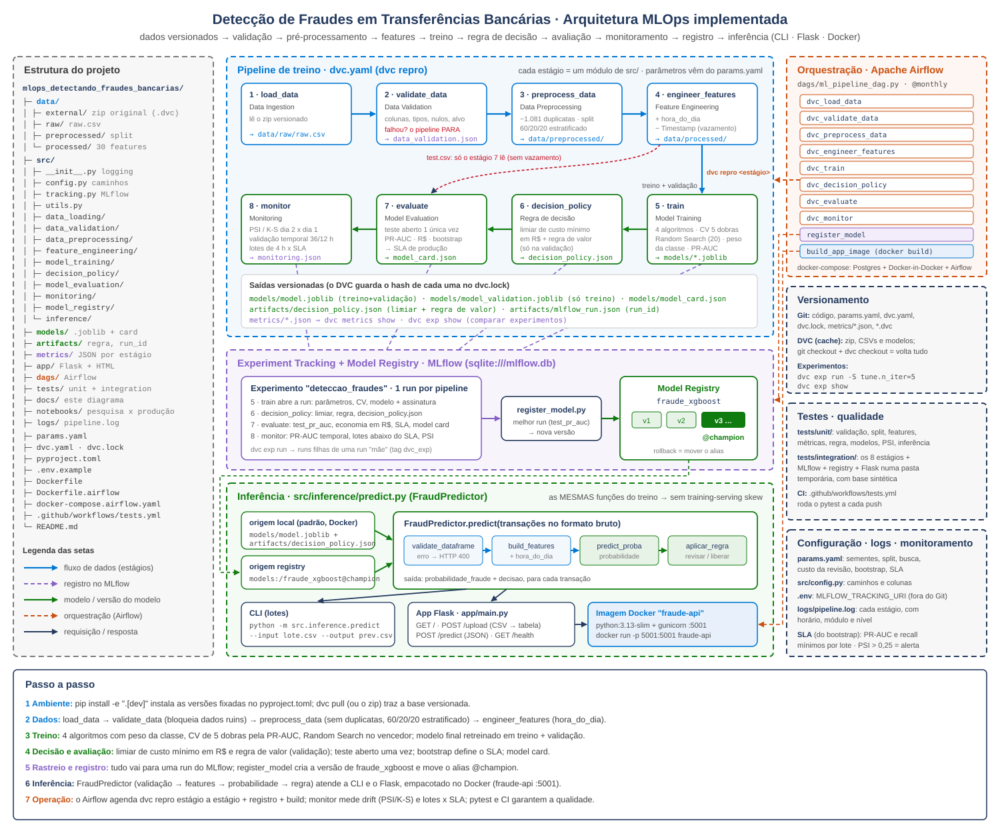

# 🕵️ Detecção de Fraudes em Transferências Bancárias com MLOps

> Do notebook à operação: o projeto de ciência de dados **"Detectando Fraudes em Transferências Bancárias – v2"** reorganizado como um sistema de Machine Learning reprodutível, versionado, testado e pronto para servir previsões.



---

## Sumário

1. [Apresentação e objetivo](#1-apresentação-e-objetivo)
2. [Problema de negócio](#2-problema-de-negócio)
3. [O que é MLOps e como ele aparece aqui](#3-o-que-é-mlops-e-como-ele-aparece-aqui)
4. [Arquitetura geral](#4-arquitetura-geral)
5. [Cada pasta e cada arquivo](#5-cada-pasta-e-cada-arquivo)
6. [Responsabilidade de cada módulo](#6-responsabilidade-de-cada-módulo)
7. [Fluxo de processamento dos dados](#7-fluxo-de-processamento-dos-dados)
8. [Fluxo de treinamento e avaliação](#8-fluxo-de-treinamento-e-avaliação)
9. [Versionamento e acompanhamento dos experimentos](#9-versionamento-e-acompanhamento-dos-experimentos)
10. [Como executar do zero](#10-como-executar-do-zero)
11. [Como executar os testes](#11-como-executar-os-testes)
12. [Como fazer previsões](#12-como-fazer-previsões)
13. [Como reproduzir todo o pipeline](#13-como-reproduzir-todo-o-pipeline)
14. [Tecnologias e por que cada uma](#14-tecnologias-e-por-que-cada-uma)
15. [Glossário](#15-glossário)
- [Resultados da execução](#resultados-da-execução)
- [Do notebook ao código: onde está cada decisão](#do-notebook-ao-código-onde-está-cada-decisão)
- [Limitações](#limitações)
- [Como repetir esta arquitetura em outro projeto](#como-repetir-esta-arquitetura-em-outro-projeto)

---

## 1. Apresentação e objetivo

Este projeto pega um modelo que já existia **dentro de um notebook** e o transforma num **pipeline de MLOps**. A lógica de Ciência de Dados foi preservada: mesmos algoritmos, variáveis, balanceamento, métricas, regra de decisão e sementes. O que muda é **como** ela é organizada e executada.

| No notebook | Neste projeto |
|---|---|
| ~210 células, executadas à mão, numa ordem que depende de quem roda | 8 estágios independentes, executados sempre na mesma ordem por `dvc repro` |
| Caminhos e constantes espalhados pelas células | Tudo em `params.yaml` e `src/config.py` |
| Resultado depende do estado do kernel | Resultado depende só do código, dos dados e dos parâmetros, todos versionados |
| Modelo salvo como um `.pkl` solto | Modelo versionado pelo DVC **e** registrado no MLflow, com número de versão e alias |
| Sem testes | 39 testes automáticos (unitários + integração) e CI |
| Prever = abrir o notebook | Prever = CLI, API Flask ou container Docker |
| Execução manual | Orquestração agendada com Airflow |

**Objetivo didático:** ao olhar qualquer pasta ou arquivo, você deve conseguir responder *por que ele existe, qual problema resolve, quem o usa e em que etapa do ciclo de MLOps ele está*. Cada arquivo `.py` começa com um docstring respondendo exatamente isso.

## 2. Problema de negócio

Um banco quer **barrar transferências fraudulentas** sem travar os clientes legítimos.

- A base tem **284.807 transações em 48 horas**. Só **0,17% são fraudes**: há cerca de 600 transações legítimas para cada fraude.
- Cada fraude que passa custa **o valor da transação**. Cada transação enviada para revisão manual custa **R$ 5** (o tempo de um analista).
- Por isso a pergunta não é "o modelo acerta?". Um modelo que diz sempre "legítima" acerta 99,83% e não serve para nada. A pergunta é:

> *Quantas fraudes, e quanto dinheiro, o banco barra revisando só as transações que o modelo marcar? Quanto custam essas revisões?*

O modelo devolve uma **probabilidade de fraude**. Uma **regra de decisão**, escolhida pelo menor custo em reais, define quem vai para revisão.

> ⚠️ **Sobre os dados:** é o conjunto público *Credit Card Fraud Detection* (ULB/Kaggle), com as colunas renomeadas. 28 das 30 variáveis são **componentes PCA anônimas**: `pais`, `cep`, `crt` etc. não significam país, CEP ou cartão. O valor real da transação é `hist_saldo`.

## 3. O que é MLOps e como ele aparece aqui

**MLOps** (Machine Learning Operations) é o conjunto de práticas que leva um modelo do notebook para a operação **e o mantém funcionando**. Ele aplica ao ML o que o DevOps aplica ao software: automação, versionamento, testes, entrega contínua e monitoramento. A diferença é que em ML há três coisas que mudam e precisam ser controladas: **código, dados e modelo**.

| Prática de MLOps | O problema que resolve | Onde está neste projeto |
|---|---|---|
| Organização e versionamento dos dados | "Qual base gerou este modelo?" | `data/` em camadas + DVC (`*.dvc`, `dvc.lock`) |
| Data Validation | Treinar com dados quebrados sem perceber | `src/data_validation/` (o pipeline para se falhar) |
| Data Preprocessing | Limpeza e separação feitas de jeitos diferentes a cada vez | `src/data_preprocessing/` |
| Feature Engineering | Treino e produção transformando dados de jeitos diferentes | `src/feature_engineering/` (a mesma função na inferência) |
| Model Training | Treino não reprodutível | `src/model_training/` + sementes no `params.yaml` |
| Model Evaluation | Métrica errada (acurácia) e teste "espiado" | `src/decision_policy/`, `src/model_evaluation/` |
| Experiment Tracking | "Qual configuração deu aquele resultado?" | MLflow (`src/tracking.py`) |
| Model Registry | "Qual modelo está em produção? Como volto ao anterior?" | MLflow Registry (`src/model_registry/`) |
| Model Serialization | Previsão que depende do notebook aberto | `models/*.joblib` + `artifacts/decision_policy.json` |
| Inference | Usar o modelo sem conhecer o treino | `src/inference/predict.py`, `app/`, `Dockerfile` |
| Pipeline Orchestration | Etapas rodadas à mão, fora de ordem | `dvc.yaml` (DVC) + `dags/` (Airflow) |
| Testing | Mudança que quebra algo sem ninguém ver | `tests/` + `.github/workflows/tests.yml` |
| Logging | "O que aconteceu na execução de ontem?" | `src/__init__.py` → `logs/pipeline.log` |
| Configuration Management | Parâmetros escondidos no código | `params.yaml`, `src/config.py`, `.env` |
| Reproducibility | "Na minha máquina funcionava" | Versões fixas (`pyproject.toml`), sementes, DVC, Docker |
| Monitoring | O modelo envelhece e ninguém percebe | `src/monitoring/` (PSI, K-S, SLA por lote) |

## 4. Arquitetura geral

O diagrama completo está em [`docs/arquitetura.svg`](docs/arquitetura.svg). Em resumo:

```
                        params.yaml (todos os parâmetros)
                                     │
data/external/transferencias.zip ──► 1 load_data ──► 2 validate_data ──► 3 preprocess_data ──► 4 engineer_features
      (versionado pelo DVC)          data/raw/         (para se falhar)    data/preprocessed/     data/processed/
                                                                                                     │
        ┌────────────────────────────────────────────────────────────────────────────────────────────┘
        ▼
    5 train ──────────► 6 decision_policy ──────► 7 evaluate ───────────► 8 monitor
    models/*.joblib     artifacts/decision_       metrics/evaluation.json  metrics/monitoring.json
                        policy.json               models/model_card.json
        │                     │                         │                       │
        └─────────────────────┴──── MLflow: 1 run por pipeline ─────────────────┘
                                             │
                                  register_model.py ──► Model Registry: fraude_xgboost @champion
                                                                     │
          FraudPredictor (validar → features → probabilidade → regra) ◄──┘ (ou models/ local)
                 │                        │                          │
           CLI predict.py         App Flask (/predict, /upload)   Docker (gunicorn :5001)

    Airflow (dags/): dvc repro <cada estágio> → register_model → docker build      [orquestração]
    Git + DVC: versionam código, parâmetros, dados e modelos                       [reprodutibilidade]
    pytest + GitHub Actions: 33 testes unitários + 6 de integração                 [qualidade]
```

**Três ideias organizam tudo:**
1. **Um estágio = uma responsabilidade = um módulo.** Cada estágio lê do disco o que o anterior gravou e grava o que o próximo vai ler. Dá para rodar, testar e entender cada um isoladamente.
2. **Uma única fonte da verdade.** A validação e as features usadas no treino são **as mesmas funções** chamadas pela inferência. Os parâmetros vivem só no `params.yaml`.
3. **Tudo que gera resultado é versionado.** Código (Git), dados e modelos (DVC), execuções (MLflow) e ambiente (pyproject + Docker).

## 5. Cada pasta e cada arquivo

> Para cada item: **por que existe** · **quem usa** · **etapa do ciclo de MLOps**.

### Raiz

| Arquivo | Por que existe / o que resolve | Quem usa | Etapa |
|---|---|---|---|
| `params.yaml` | Todos os parâmetros (semente, split, busca, custo da revisão, SLA...) num lugar só. Mudar um valor aqui faz o DVC refazer só os estágios afetados | todos os estágios; `dvc exp run -S` | Configuration Management |
| `dvc.yaml` | Define o pipeline: comando, dependências, parâmetros e saídas de cada estágio | `dvc repro`, Airflow | Orchestration / Reproducibility |
| `dvc.lock` | "Fotografia" da última execução: o hash de cada dado, parâmetro e saída. É o que garante que o resultado pode ser reproduzido | DVC, Git | Reproducibility |
| `pyproject.toml` | Nome do pacote e dependências com **versões fixas** | `pip install -e .`, Docker | Reproducibility |
| `.env.example` / `.env` | Configurações de ambiente (onde está o MLflow) fora do código. O `.env` não vai para o Git | `src/__init__.py` | Configuration Management |
| `.gitignore`, `.dvcignore`, `.gitattributes` | O que o Git e o DVC ignoram; finais de linha padronizados | Git, DVC | Versionamento |
| `Dockerfile`, `.dockerignore` | Imagem do app: código + dependências + modelo, rodando igual em qualquer máquina | `docker build` | Deployment |
| `Dockerfile.airflow`, `Dockerfile.airflow.dockerignore`, `docker-compose.airflow.yaml` | Airflow conteinerizado (Postgres + Docker-in-Docker + Airflow) com o projeto dentro | `docker compose` | Orchestration |

### `data/`: dados em camadas (versionados pelo DVC, não pelo Git)

| Pasta | Conteúdo | Quem grava → quem lê |
|---|---|---|
| `external/` | `transferencias.zip`, a base original intacta. No Git vai só o `transferencias.zip.dvc` (o "ponteiro" com o hash) | `dvc add` → `load_data` |
| `raw/` | `raw.csv`: a base bruta (284.807 × 31), sem nenhuma alteração | `load_data` → `validate_data`, `preprocess_data` |
| `preprocessed/` | `train/val/test.csv` sem duplicatas e com `id_transacao`; `train_val_ids.csv` (a ordem de treino + validação para a validação cruzada) | `preprocess_data` → `engineer_features`, `train`, `monitor` |
| `processed/` | `train/val/test.csv` com as 30 variáveis do modelo | `engineer_features` → `train`, `decision_policy`, `evaluate` |

**Por que camadas?** Se algo der errado no estágio 4, não é preciso reler o zip. E cada camada pode ser inspecionada para auditar o que cada estágio fez.

### `src/`: o código do pipeline (um subpacote por etapa)

| Arquivo | Responsabilidade |
|---|---|
| `__init__.py` | Carrega o `.env` e configura o **logging** do projeto (terminal + `logs/pipeline.log`) |
| `config.py` | Caminhos de todos os arquivos, nomes das colunas e leitura do `params.yaml`. A raiz pode ser trocada por `FRAUD_PROJECT_ROOT`, que os testes usam |
| `utils.py` | Ler e gravar JSON e CSV sempre do mesmo jeito (CSV lido em modo *round trip*, para os números voltarem idênticos) |
| `tracking.py` | Conecta ao MLflow, abre a run no treino e a reabre nos estágios seguintes |
| `data_loading/load_data.py` | Estágio 1: zip → `data/raw/raw.csv` |
| `data_validation/validate_data.py` | Estágio 2: regras de qualidade; **interrompe** o pipeline se uma regra bloqueante falhar. Também protege a inferência |
| `data_preprocessing/preprocess_data.py` | Estágio 3: remove duplicatas e separa 60/20/20 estratificado |
| `feature_engineering/engineer_features.py` | Estágio 4: `hora_do_dia` e remoção do `Timestamp`. Função sem estado, reutilizada na inferência |
| `model_training/models.py` | Os 4 modelos, o balanceamento e os espaços de busca (idênticos ao notebook) |
| `model_training/train_model.py` | Estágio 5: comparação, validação cruzada, Random Search, modelo final; registro no MLflow |
| `decision_policy/optimize_threshold.py` | Estágio 6: limiar de custo mínimo e regra de valor, **na validação** |
| `model_evaluation/metrics.py` | Biblioteca: métricas, custo em reais, `aplicar_regra`, bootstrap |
| `model_evaluation/evaluate_model.py` | Estágio 7: teste aberto uma vez, bootstrap, SLA e model card |
| `monitoring/drift.py` | Biblioteca: PSI, K-S, desempenho por lote e situação do SLA |
| `monitoring/monitor.py` | Estágio 8: drift dia 2 × dia 1, validação temporal, lotes de 4 h × SLA |
| `model_registry/register_model.py` | Cria a versão no Model Registry e aponta o alias `champion` |
| `inference/predict.py` | `FraudPredictor` + CLI: prevê transações novas a partir dos arquivos locais ou do registry |

### Saídas do pipeline

| Pasta | Conteúdo | Por que fica separado |
|---|---|---|
| `models/` | `model.joblib` (produção: treino + validação), `model_validation.joblib` (só treino: usado para escolher o limiar), `model_card.json` (ficha do modelo) | São os artefatos que vão para produção |
| `artifacts/` | `decision_policy.json` (limiar + regra de valor) e `mlflow_run.json` (id da run) | O modelo sozinho não decide: a regra é parte do produto |
| `metrics/` | Um JSON por estágio. O DVC lê com `dvc metrics show` e compara versões com `dvc metrics diff` | Métricas pequenas ficam no Git, para comparar commits |
| `logs/` | `pipeline.log` | Histórico das execuções |
| `mlruns/`, `mlflow.db` | Banco e arquivos do MLflow (fora do Git) | Rastreio de experimentos |

### Demais pastas

| Pasta | Conteúdo |
|---|---|
| `app/` | `main.py` (Flask: `/`, `/upload`, `/predict`, `/health`) e `templates/index.html` |
| `dags/` | `ml_pipeline_dag.py`: a DAG do Airflow |
| `tests/` | `conftest.py` (base sintética), `unit/` (33 testes) e `integration/` (6 testes do pipeline completo) |
| `docs/` | `arquitetura.svg` |
| `notebooks/` | `README.md` explicando a separação pesquisa × produção (o notebook original continua no projeto de origem) |
| `.github/workflows/` | `tests.yml`: CI que roda o pytest a cada push |

## 6. Responsabilidade de cada módulo

Todos os estágios seguem o mesmo molde do projeto-exemplo:

```python
def funcao_pura(dados, parametros) -> resultado:   # faz o trabalho; testável, sem ler/gravar disco
    ...

def main() -> None:                                # orquestra: lê params e entradas, chama a função, grava as saídas
    params = load_params()
    entrada = read_csv(PATHS.algo)
    saida = funcao_pura(entrada, params[...])
    save_json(saida, PATHS.metrics_dir / "algo.json")

if __name__ == "__main__":                         # python -m src.<etapa>.<modulo>
    main()
```

**Por que separar a "função pura" do `main()`?** Os testes chamam a função pura com dados pequenos, sem disco. O DVC e o Airflow chamam o `main()`. Isso não existia no projeto-exemplo, onde os caminhos ficavam dentro das funções e dificultavam testar.

| Módulo | Entradas | Saídas | Funções principais |
|---|---|---|---|
| `load_data` | zip | `raw.csv` | `fetch_data`, `save_data` |
| `validate_data` | `raw.csv` | `data_validation.json` (ou erro) | `validate_dataframe` |
| `preprocess_data` | `raw.csv` | 3 partes + ordem | `remover_duplicatas`, `split_data` |
| `engineer_features` | partes pré-processadas | partes com 30 variáveis | `hora_do_dia`, `build_features` |
| `train_model` | treino, validação | 2 modelos, `train.json`, run MLflow | `compare_models`, `cross_validate_models`, `tune_model`, `train_pipeline` |
| `optimize_threshold` | modelo de validação, validação | `decision_policy.json` | `escolher_limiar`, `escolher_regra_valor`, `optimize_policy` |
| `evaluate_model` | modelo final, política, teste | `evaluation.json`, `model_card.json` | `evaluate`, `build_model_card` |
| `monitor` | base completa, modelos, SLA | `monitoring.json` | `drift_between_days`, `temporal_validation` |
| `register_model` | run do MLflow | versão no registry | `choose_run`, `register_model` |
| `predict` | CSV/DataFrame bruto | probabilidade + decisão | `FraudPredictor.predict` |

## 7. Fluxo de processamento dos dados

```
transferencias.zip (284.807 × 31)
   │ 1 load_data: lê o CSV de dentro do zip, sem alterar nada
   ▼
data/raw/raw.csv
   │ 2 validate_data: 31 colunas? numéricas? sem nulos/infinitos? Timestamp e valor >= 0?
   │                  alvo só 0/1 e com as duas classes?  → se não: ERRO e o pipeline para
   │                  (registra também: 1.081 duplicatas, taxa de fraude 0,17%)
   ▼
   │ 3 preprocess_data: remove 1.081 duplicatas (19 eram fraudes) → 283.726 transações, 473 fraudes
   │                    cria id_transacao; separa ESTRATIFICADO:
   │                       teste      20% = 56.746 (95 fraudes)  ← trancado até o estágio 7
   │                       validação  20% = 56.745 (94 fraudes)  ← escolhe o limiar
   │                       treino     60% = 170.235 (284 fraudes)
   ▼
data/preprocessed/{train,val,test}.csv
   │ 4 engineer_features: hora_do_dia = (Timestamp mod 86.400) / 3.600; remove Timestamp
   ▼
data/processed/{train,val,test}.csv  (28 componentes + hist_saldo + hora_do_dia + Target)
```

**Onde o vazamento de dados (data leakage) é evitado:**

| Risco | Como foi evitado |
|---|---|
| Uma duplicata no treino e a cópia no teste | Duplicatas removidas **antes** da separação |
| `Timestamp` (posição na janela de 48 h, que nunca se repete) | Trocado por `hora_do_dia` |
| Escala ou SMOTE ajustados com dados de validação | Ficam **dentro** do Pipeline: ajustados só no treino de cada dobra |
| Peso da classe calculado com a base toda | `scale_pos_weight` calculado só com o treino |
| Limiar escolhido no teste | Escolhido na validação, com o modelo treinado só no treino |
| "Espiar" o teste | Só o estágio 7 lê `test.csv` |

## 8. Fluxo de treinamento e avaliação

```
5 train
  ├─ treina XGBoost, Random Forest, LightGBM e Regressão Logística (peso da classe) no treino
  ├─ mede na validação (limiar 0,5) → métricas e sobreajuste (PR-AUC treino x validação)
  ├─ validação cruzada 5 dobras em treino+validação → escolhe o algoritmo pela PR-AUC média
  ├─ Random Search (20 combinações, 3 dobras do treino) no vencedor
  ├─ usa o ajustado só se a PR-AUC da busca superar a do padrão nas MESMAS 3 dobras
  ├─ model_validation.joblib = escolhido, treinado só no treino
  └─ model.joblib = clone retreinado em treino+validação (80% da base)
6 decision_policy  (validação, com model_validation)
  ├─ limiar de custo mínimo de 0,01 a 0,99: custo = fraudes perdidas (R$) + revisões x R$ 5
  └─ regra de valor (4 cortes × 7 limiares): adotada só se aumentar a economia
7 evaluate  (teste, com model.joblib, UMA vez)
  ├─ métricas da regra final, resultado em reais, comparação com o limiar 0,5
  ├─ bootstrap estratificado (1.000 amostras): intervalos de 95%
  ├─ SLA = limites inferiores do bootstrap (PR-AUC e recall mínimos em produção)
  └─ model_card.json: o que é o modelo, como usar, métricas, avisos
8 monitor
  ├─ PSI e K-S do dia 2 contra o dia 1 (variáveis monitoradas + score do modelo)
  ├─ validação temporal: treina nas primeiras 36 h, avalia nas últimas 12 h
  └─ lotes de 4 h comparados ao SLA (simula o gabarito chegando com atraso)
```

**Métricas, e por que estas:**

| Métrica | Por que importa aqui |
|---|---|
| **PR-AUC** (principal) | Mede se as fraudes ficam no topo da lista. O sorteio dá 0,0017; não depende do limiar |
| Recall | Das fraudes, quantas foram barradas |
| Precisão | Das revisões, quantas eram fraude (define o tamanho da fila) |
| **Economia líquida (R$)** | Valor barrado − custo das revisões: é o critério do limiar |
| AUC-ROC | Registrada, mas com 0,17% de fraudes fica perto de 1 com facilidade |
| ~~Acurácia~~ | "Nunca é fraude" acerta 99,83%: não serve |

## 9. Versionamento e acompanhamento dos experimentos

Três ferramentas, três perguntas:

| Ferramenta | Pergunta que responde | O que versiona |
|---|---|---|
| **Git** | "Qual código e qual configuração?" | `src/`, `params.yaml`, `dvc.yaml`, `dvc.lock`, `metrics/*.json`, `*.dvc` |
| **DVC** | "Quais dados e qual modelo?" | zip, CSVs e `.joblib`, guardados num cache e apontados pelo hash no `dvc.lock` |
| **MLflow** | "Como foi cada execução, e qual modelo está em produção?" | Runs (parâmetros, métricas, artefatos, modelo) e o Model Registry |

**Voltar no tempo:** `git checkout <commit>` + `dvc checkout` restaura código, parâmetros, dados e modelos daquela versão.

**Experimentos sem editar arquivos** (exemplo de execução real na seção de resultados):

```bash
python -m dvc exp run -S tune.n_iter=5                      # menos combinações na busca
python -m dvc exp run -S train.balanceamento=smote          # testar o SMOTE (dentro do Pipeline)
python -m dvc exp run -S decision_policy.custo_revisao=10   # outra premissa de custo
python -m dvc exp show                                       # tabela comparando parâmetros e métricas
python -m dvc exp apply <nome>                               # adotar um experimento
```

No MLflow, cada experimento do DVC vira uma **run filha** de uma run "mãe" (tag `dvc_exp`). O `register_model` escolhe a filha de maior `test_pr_auc`.

**Acompanhar no MLflow:**

```bash
mlflow ui --backend-store-uri sqlite:///mlflow.db      # http://localhost:5000
```

Em *Experiments → deteccao_fraudes* ficam as runs. Em *Models → fraude_xgboost*, as versões e o alias `@champion`. Para **promover** um modelo novo, mova o alias para a nova versão. Para fazer **rollback**, mova-o de volta.

## 10. Como executar do zero

Pré-requisitos: Python 3.12+ e Git. Docker é opcional (só para o app em container e o Airflow).

```bash
# 1) Ambiente isolado + dependências fixadas
python -m venv .venv
.venv\Scripts\activate          # Windows   |   source .venv/bin/activate  (Linux/Mac)
pip install -e ".[dev]"

# 2) Configuração local
copy .env.example .env          # Windows   |   cp .env.example .env

# 3) Dados: o zip original em data/external/ (com remoto DVC configurado: python -m dvc pull)

# 4) Pipeline completo (~45 min com os parâmetros do notebook)
python -m dvc repro

# 5) Registrar o modelo no MLflow Model Registry
python -m src.model_registry.register_model
```

> 💡 **Rodar uma vez mais rápido:** `python -m dvc exp run -S tune.n_iter=3 -S train.cv_folds_comparacao=3`.
>
> 💡 Usamos `python -m dvc` em vez de `dvc` porque, nesta máquina, uma política de segurança do Windows bloqueia o executável `dvc.exe`. Os dois são equivalentes.

Para rodar **um estágio isolado** (como no projeto-exemplo): `python -m src.data_preprocessing.preprocess_data`.

## 11. Como executar os testes

```bash
pytest                       # todos (≈ 5 min)
pytest tests/unit            # só unitários (≈ 5 min: inclui gravar os 8 modelos no MLflow)
pytest -m integration        # só o pipeline completo com a base sintética
```

- **Unitários (33):** validação (aprova a base certa; reprova coluna faltando, nulos, valor negativo, alvo fora de 0/1, texto), split (60/20/20, estratificado, sem sobreposição, reprodutível), features, métricas, custo em reais, regra de decisão, escolha do limiar e da regra de valor, construção dos modelos (peso da classe, SMOTE dentro do Pipeline), PSI, K-S, lotes, inferência, o app e a gravação de todos os algoritmos no MLflow (skops).
- **Integração (6):** os 8 estágios + registro rodam de ponta a ponta numa **pasta temporária** com uma **base sintética** (mesmo esquema, 4 mil linhas). Os testes conferem as saídas, a ausência de sobreposição entre as partes, a run e o alias no MLflow, que a inferência local e a do registry dão o mesmo resultado, e as rotas do Flask.

**Por que uma base sintética?** O teste verifica o *encanamento*, não a qualidade do modelo. Ele precisa rodar em segundos, em qualquer máquina e no CI, sem os 150 MB reais.

## 12. Como fazer previsões

A entrada é sempre o **formato bruto** da base: `Timestamp`, as 28 componentes e `hist_saldo`. A hora do dia é calculada pelo próprio sistema, com a mesma função do treino.

**CLI (lotes):**
```bash
python -m src.inference.predict --input lote.csv --output previsoes.csv
python -m src.inference.predict --input lote.csv --source registry      # usa o modelo @champion do MLflow
```

**API Flask:**
```bash
python -m app.main                                   # http://localhost:5001
```
- Navegador: envie um CSV em `http://localhost:5001`.
- API:
```bash
curl -X POST http://localhost:5001/predict -H "Content-Type: application/json" \
     -d '{"transacoes": [{"Timestamp": 3600, "pais": -1.2, "...": 0, "hist_saldo": 149.62}]}'
# → {"modelo": "local: model.joblib", "previsoes": [{"probabilidade_fraude": 0.0001, "decisao": "liberar"}]}
```
- Saúde: `GET /health` mostra o modelo carregado e a regra em uso.

**Docker** (rode o pipeline antes, para existirem `models/` e `artifacts/`):
```bash
docker build -t fraude-api .
docker run -p 5001:5001 fraude-api
```

**Origem do modelo:** `inference.model_source` no `params.yaml` aceita `local` (padrão, lê `models/` + `artifacts/`) ou `registry` (lê `models:/fraude_xgboost@champion` e a regra de decisão da mesma run).

## 13. Como reproduzir todo o pipeline

```bash
python -m dvc repro          # refaz só o que mudou (código, dados ou parâmetros)
python -m dvc repro -f       # força refazer tudo
python -m dvc dag            # mostra o grafo dos estágios
python -m dvc status         # o que está desatualizado
python -m dvc metrics show   # métricas atuais
python -m dvc params diff    # o que mudou nos parâmetros desde o último commit
```

**Garantias de reprodutibilidade implementadas:**
- **mesmas sementes** (`seed: 42`) em split, modelos, busca e bootstrap;
- **mesmas versões** de todas as bibliotecas (`pyproject.toml`);
- **CSV lido em *round trip*:** cada número volta idêntico ao gravado;
- **ordem das linhas preservada** (`train_val_ids.csv`), porque a validação cruzada depende dela;
- **`dvc.lock`** com o hash de cada entrada e saída.

Rodar `dvc repro` duas vezes sem mudar nada responde *"Data and pipelines are up to date"*.

### Airflow (orquestração agendada)

```bash
docker compose -f docker-compose.airflow.yaml build
docker compose -f docker-compose.airflow.yaml up -d      # http://localhost:8080 (admin / admin)
```

A DAG `fraud_detection_pipeline` cria uma tarefa por estágio do `dvc.yaml`, seguida de `register_model` e `build_app_image`, e roda `@monthly` (o plano de retreino mensal do notebook) ou sob demanda. O projeto roda num ambiente Python separado dentro do container, para as bibliotecas do projeto não conflitarem com as do Airflow.

### DagsHub (remoto, opcional)

Para compartilhar dados e experimentos, como no curso:
```bash
python -m dvc remote add origin https://dagshub.com/<usuario>/<repo>.dvc
python -m dvc remote modify origin --local auth basic
python -m dvc remote modify origin --local user <usuario>
python -m dvc remote modify origin --local password <token>
python -m dvc push
```
e, no `.env`, `MLFLOW_TRACKING_URI=https://dagshub.com/<usuario>/<repo>.mlflow` (com usuário e token).

## 14. Tecnologias e por que cada uma

| Tecnologia | Para quê | Por que esta |
|---|---|---|
| **Python 3.13**, pandas, NumPy, SciPy | Base de tudo | As mesmas do notebook |
| **scikit-learn, XGBoost, LightGBM, imbalanced-learn** | Modelos, Pipeline, validação cruzada, Random Search | Preservar exatamente os algoritmos do notebook. O imblearn só entra se um experimento pedir SMOTE |
| **DVC** | Pipeline (`dvc.yaml`), versionamento de dados e modelos, experimentos | Do curso. Resolve "quais dados geraram este modelo" sem pôr arquivos grandes no Git |
| **MLflow** (SQLite local) | Rastreio de experimentos e Model Registry | Do curso. O SQLite é necessário para o registry funcionar localmente, sem servidor |
| **Flask + gunicorn** | API e página para previsões | Do projeto-exemplo. Leve e suficiente para servir um modelo |
| **Docker** | Empacotar o app; subir o Airflow | Do curso. Elimina o "na minha máquina funciona" |
| **Apache Airflow** | Agendar e orquestrar o pipeline | Do curso. O DVC sabe *como* reproduzir; o Airflow decide *quando* rodar, com novas tentativas e histórico |
| **pytest + GitHub Actions** | Testes e CI | Padrão de mercado em Python |
| **PyYAML, python-dotenv** | Ler `params.yaml` e `.env` | Do curso |

**O que ficou de fora, e por quê:**
- **TensorFlow:** do projeto-exemplo, mas o notebook não usa rede neural.
- **Optuna:** o notebook comparou Grid, Random e Optuna, e o Random Search foi o escolhido (empate técnico). A comparação é pesquisa e continua no notebook.
- **Pandera / Great Expectations:** a validação com pandas puro cobre as regras atuais. Seriam uma melhoria se as regras crescerem.

## 15. Glossário

| Termo | Significado |
|---|---|
| **Pipeline** | Sequência automatizada de etapas, em que a saída de uma é a entrada da próxima |
| **Estágio (stage)** | Uma etapa do pipeline do DVC, com comando, dependências e saídas |
| **DAG** | Grafo dirigido sem ciclos: a ordem e as dependências das etapas (no DVC e no Airflow) |
| **Artefato** | Qualquer arquivo produzido pelo pipeline: modelo, regra, métricas, ficha |
| **Run** | Uma execução registrada no MLflow, com parâmetros, métricas, artefatos e modelo |
| **Experimento** | No MLflow, o grupo de runs de um projeto. No DVC, uma execução com parâmetros alterados (`dvc exp run`) |
| **Model Registry** | Catálogo de modelos promovidos, com versões numeradas |
| **Alias (`@champion`)** | Nome que aponta para uma versão do modelo. Promover ou fazer rollback = mover o alias |
| **Serialização** | Gravar o modelo em arquivo (`joblib`) para usá-lo depois, sem retreinar |
| **Model card** | Ficha do modelo: o que é, dados, métricas, regra, limites e avisos |
| **Data leakage** | Usar no treino informação que não existiria na hora de prever: o resultado fica bom demais e falso |
| **Training-serving skew** | Dados transformados de um jeito no treino e de outro na produção |
| **Data drift** | Mudança na distribuição das entradas. Medido pelo PSI e pelo K-S, sem gabarito |
| **Concept drift** | Mudança na relação entre entradas e alvo. Só aparece nas métricas, quando o gabarito chega |
| **PSI** | *Population Stability Index*: até 0,10 estável, até 0,25 atenção, acima de 0,25 mudança relevante |
| **SLA** | Nível mínimo de desempenho acordado (aqui, PR-AUC e recall mínimos por lote) |
| **Bootstrap** | Reamostragem com reposição para medir a incerteza de uma métrica |
| **PR-AUC** | Área sob a curva precisão × recall: a métrica certa para classes raras |
| **Reprodutibilidade** | Rodar de novo e obter o mesmo resultado |
| **CI** | *Continuous Integration*: testes automáticos a cada mudança no código |
| **Container** | Pacote isolado com app + dependências, que roda igual em qualquer lugar |

---

## Resultados da execução

Execução real do `dvc repro` em 20/11/2026: Windows 11, Python 3.13, 4 núcleos e 8 GB de RAM, ~48 min no total, sendo ~44 min do estágio `train`. **Critério de sucesso: reproduzir o notebook v2.** Todos os números abaixo bateram exatamente.

| Etapa | Notebook v2 | Pipeline MLOps |
|---|---|---|
| Duplicatas removidas / transações restantes | 1.081 / 283.726 | 1.081 / 283.726 |
| Treino / validação / teste (fraudes) | 170.235 (284) / 56.745 (94) / 56.746 (95) | idêntico |
| PR-AUC na validação: XGBoost / RF / LightGBM / Reg. Logística | 0,8913 / 0,8770 / 0,8555 / 0,7876 | 0,8913 / 0,8770 / 0,8555 / 0,7876 |
| CV 5 dobras: XGBoost | 0,848 ± 0,028 | 0,8482 ± 0,0276 |
| Random Search × padrão (3 dobras) | 0,8410 × 0,8199 → ajustado | 0,8410 × 0,8199 → ajustado |
| Hiperparâmetros | depth 4, 454 árvores, lr 0,157, peso 24,46 | idênticos |
| Limiar de custo mínimo / regra de valor | 0,11 / R$ 200 com prob. ≥ 0,005 | 0,11 / R$ 200 com prob. ≥ 0,005 |
| Teste: PR-AUC / recall / precisão | 0,8169 / 0,821 / 0,591 | 0,8169 / 0,8211 / 0,5909 |
| Teste: fraudes barradas / revisões | 78 de 95 / 132 | 78 de 95 / 132 |
| Teste: economia líquida (IC 95%) | R$ 11.494,24 (R$ 6.255 a R$ 17.940) | R$ 11.494,24 (R$ 6.255,42 a R$ 17.940,01) |
| SLA: PR-AUC / recall mínimos | 0,736 / 0,747 | 0,736 / 0,747 |
| Validação temporal (últimas 12 h): PR-AUC / precisão | 0,798 / 0,268 | 0,7977 / 0,2676 |
| PSI dia 2 × dia 1: `lim_crt` / `cep` / score | 1,05 / 0,195 / 0,035 | 1,0513 / 0,1951 / 0,0347 |
| Lotes de 4 h abaixo do SLA | 1 de 3 (44 a 48 h) | 1 de 3 (44 a 48 h) |

**Outras verificações executadas:**
- **Reprodutibilidade:** o segundo `dvc repro` e o `dvc status` responderam *"Data and pipelines are up to date"*.
- **Model Registry:** a run `63249e6a…` foi registrada como `fraude_xgboost` **v1**, com o alias `@champion`.
- **Inferência:** a CLI no lote de exemplo [`docs/exemplo_lote.csv`](docs/exemplo_lote.csv) (15 fraudes e 35 legítimas do teste) mandou 12 transações para revisão, todas fraudes. Nenhuma legítima foi marcada e 3 fraudes passaram. A origem local e a do registry deram resultados **idênticos**.
- **Flask:** `/health`, `/predict`, `/upload` e o erro 400 para entrada sem colunas, testados com o servidor de verdade.
- **Testes:** veja a seção 11.

> **O que deu errado no caminho (e virou aprendizado):** a primeira execução completa falhou ao gravar o modelo no MLflow. O MLflow 3 usa o formato seguro `skops`, que recusa tipos não declarados, como o `Booster` do XGBoost. O teste de integração não pegou o problema porque, na base sintética, o vencedor era a Regressão Logística (só tipos do scikit-learn). A correção foi declarar os tipos confiáveis (`SKOPS_TRUSTED_TYPES`) e criar um teste que grava e recarrega **todos** os algoritmos candidatos. Lição: o teste precisa cobrir todos os caminhos possíveis, e não só o que a base de teste por acaso percorre.

## Do notebook ao código: onde está cada decisão

| Decisão do notebook v2 | Onde está no projeto |
|---|---|
| Remover duplicatas antes de separar (Fase 02, 2.3) | `preprocess_data.remover_duplicatas` |
| Separação 60/20/20 estratificada, semente 42 (Fase 03, 4.1) | `preprocess_data.split_data` + `params.yaml: preprocess_data, seed` |
| Trocar `Timestamp` por `hora_do_dia` (Fase 02, 4) | `engineer_features.build_features` |
| Manter as 30 variáveis (Fase 03, 4.3) | `config.COLUNAS_MODELO` |
| Peso da classe em vez de SMOTE (Fase 03, 4.2) | `models.build_models` + `params.yaml: train.balanceamento` |
| 4 algoritmos; escolha pela PR-AUC na CV de 5 dobras (Fase 03, 5) | `train_model.compare_models`, `cross_validate_models` |
| Random Search 20 combinações, 3 dobras, PR-AUC (Fase 03, 7.2 e 7.4) | `models.search_space` + `train_model.tune_model` |
| Ajustado só se a CV superar o padrão (Fase 03, 7.5) | `train_model.tune_model` (`usar_ajustado`) |
| Modelo final em treino + validação (Fase 03, 7.6) | `train_model.train_pipeline` |
| Limiar de custo mínimo, revisão a R$ 5 (Fase 03, 8.2) | `optimize_threshold.escolher_limiar` + `params.yaml: decision_policy` |
| Regra complementar de valor (Fase 03, 8.5) | `optimize_threshold.escolher_regra_valor` |
| Teste aberto uma única vez (Fase 03, 7.6; Fase 04) | só `evaluate_model` lê `test.csv` |
| Bootstrap e SLA (Fase 04, 1.1; Fase 05, 3) | `metrics.bootstrap_decisoes`, `bootstrap_pr_auc` + `evaluate_model.evaluate` |
| Validação temporal 36 h / 12 h (Fase 04, 1.2) | `monitor.temporal_validation` |
| PSI/K-S e lotes × SLA (Fase 05, 3) | `drift.py` + `monitor.py` |
| Ficha do modelo (Fase 05, 1) | `evaluate_model.build_model_card` → `models/model_card.json` |

**Ficaram no notebook (pesquisa, não produção):** EDA e as 6 hipóteses, a comparação SMOTE × peso, a seleção de variáveis, Grid × Random × Optuna, a calibração isotônica e o peso pelo valor (ambos rejeitados), o teste anti-vazamento, a permutação e o SHAP. O pipeline implementa as **decisões** tiradas desses estudos.

## Limitações

- **Só 2 dias de dados.** Os padrões de fraude mudam; a validação temporal cobre só 12 horas.
- **Componentes PCA anônimas.** O modelo só vale para dados gerados com o mesmo PCA, e não dá para explicar ao cliente, em termos de negócio, por que uma transação foi barrada.
- **Premissa de custo.** A revisão a R$ 5 é uma suposição. Os valores, chamados de reais, estão em euros na base pública.
- **Monitoramento simulado.** O estágio `monitor` usa os dois dias da base. Em produção, ele rodaria sobre as transações novas, agendado no Airflow.
- **MLflow local.** Com SQLite, as runs ficam só nesta máquina. Para compartilhar, use um servidor (ou o DagsHub).

## Como repetir esta arquitetura em outro projeto

1. **Separe pesquisa de produção.** O notebook decide; o pipeline executa a decisão. Liste as decisões do notebook (a tabela acima é o modelo).
2. **Crie a estrutura:** `data/{external,raw,preprocessed,processed}`, `src/<etapa>/`, `models/`, `artifacts/`, `metrics/`, `tests/`.
3. **Centralize a configuração:** `src/config.py` com os caminhos e `params.yaml` com todo número "mágico" (semente, frações, hiperparâmetros, custos).
4. **Um estágio por responsabilidade**, no molde *função pura + `main()`*. Cada estágio lê do disco o que o anterior gravou.
5. **Valide os dados** antes de tudo e reaproveite a validação na inferência.
6. **Torne as transformações funções reutilizáveis.** A inferência deve chamar as mesmas funções do treino.
7. **Escreva o `dvc.yaml`** com deps, params, outs e metrics. Rode `dvc repro`.
8. **Instrumente com MLflow:** uma run por pipeline, parâmetros + métricas + modelo; registre com alias.
9. **Escreva testes:** unitários nas funções puras; um de integração rodando o pipeline numa base sintética e numa pasta temporária.
10. **Sirva o modelo:** uma classe de inferência + Flask + Dockerfile.
11. **Orquestre:** uma DAG do Airflow que chama `dvc repro <estágio>` para cada estágio.
12. **Documente:** um docstring por módulo (por quê, entradas, saídas, etapa do ciclo), o README e o diagrama.
